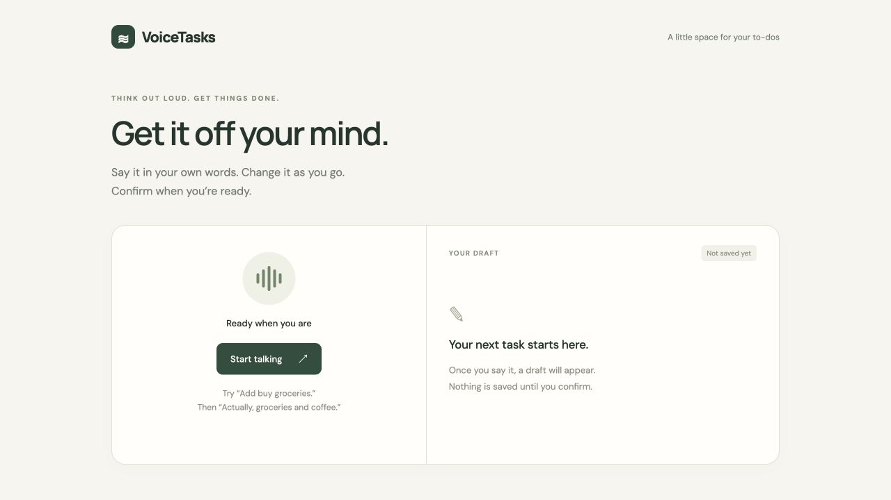

# VoxProof — VoiceTasks MVP

**Think out loud. Get things done.**

A small local voice app built with React, Python, SQLite, and a real ElevenLabs agent. Speak a task, correct it out loud, and click Confirm to save it once. One screen, one draft, one explicit save.

This repository keeps the **VoxProof** name. Its first release is **VoiceTasks**, a focused working voice interaction rather than the original larger agent-testing dashboard.



## Try it

1. Click **Start talking** and allow microphone access.
2. Say **“Add buy groceries.”** A draft appears.
3. Interrupt: **“Actually, buy groceries and coffee.”** The same draft changes.
4. Click **Confirm & save**. The conversation stops and one task is saved.
5. Refresh the page: the task is still there.
6. Click **Done** beside a saved task to mark it complete. Click **Undo** to reopen it. Both changes survive refreshes; completed tasks stay visible.

**Cancel** discards an unconfirmed draft. **Stop conversation** ends the microphone session and keeps the draft for review. Voice alone cannot confirm a task.

## Run locally

Requires Python 3.11+ and Node.js 24. Start from a fresh clone:

```sh
git clone https://github.com/humblethinker/voxproof.git
cd voxproof
python3 -m venv .venv
source .venv/bin/activate
python -m pip install -r backend/requirements.lock.txt
npm ci --prefix web
cp .env.example .env   # First setup only; keep an existing .env
```

On Windows, activate the environment with `.venv\Scripts\activate` instead.

Set `ELEVENLABS_API_KEY` in `.env`. The key needs Agents read/write access for the one-time setup, and access to the resulting agent for voice sessions. Then create a dedicated private agent:

```sh
python scripts/create_agent.py
```

The script creates the `set_task_draft` client tool, creates a VoiceTasks agent, and writes its ID to `.env`. Re-running it reuses the recorded configuration. It does not modify other agents. Agent prompt and tool schema are in `agent/`. If you already have a compatible agent, put its ID in `.env` instead.

Start both servers with one command:

```sh
python scripts/dev.py
```

Keep that terminal open. **Ctrl+C** stops both servers. If localhost refuses the connection after a restart, activate `.venv` and run the same command again. If a port is already occupied, the launcher reports it rather than replacing another process.

For separate terminals, run the API from the repository root and the frontend from `web/`:

```sh
uvicorn backend.app:app --host 127.0.0.1 --port 8001
# Second terminal:
npm run dev --prefix web
```

Open **http://127.0.0.1:5174**. Chrome or Edge is recommended for the microphone test. The app needs a network connection and ElevenLabs usage credits. No ElevenLabs key is embedded in the frontend.

## How it works

```text
React → Python: request a short-lived signed conversation URL
React ↔ ElevenLabs: microphone + agent audio over WebSocket
Agent → React: set_task_draft(title), including spoken corrections
Human clicks Confirm → Python → SQLite
```

The agent can only update an unsaved draft. Confirm freezes the visible title, rejects late tool calls, and sends a UUID request ID with the save. SQLite enforces a unique request ID: retries return the existing task, and a retry with a different title is rejected. Cancel never calls the save endpoint.

If a save response is lost, **Retry save** uses the same title and request ID. Keep that tab open until the result is confirmed; pending drafts are held in memory. Saved tasks persist in `.local/tasks.sqlite3`.

## Test

```sh
source .venv/bin/activate
python -m pytest -q backend/tests
cd web
npm test
npm run build
```

Tests cover persistence across app restarts, concurrent duplicate saves, conflicting retries, validation, session errors, corrections, cancellation, stale tool callbacks, double clicks, and retrying a lost save response. Browser component tests mock the voice SDK and HTTP layer; they do not exercise a physical microphone.

Completion tests also cover upgrading existing databases without losing tasks, completing and undoing after refresh, repeated status requests, and failed responses. Existing tasks start as incomplete on upgrade. Completion is controlled by the task-list buttons; the voice agent still only updates drafts.

An optional **live audio check** uses macOS `say` and `afconvert` to stream synthetic speech to the real agent. It consumes ElevenLabs credits, never opens the microphone, and saves no tasks:

```sh
python scripts/smoke_voice.py
```

On October 24, 2026 (Dublin time), this check received both spoken transcripts, two draft tool calls (`Buy groceries` → `Buy groceries and coffee`), an interruption event, and agent audio. The reproducible script writes its result and input WAV files to `.local/smoke/`.

The local browser conversation also produced **Buy coffee and groceries** after a spoken correction. It appeared as one saved task after confirmation and remained present after a page refresh. Automated checks cover the app and publication guards; GitHub Actions runs them on pushes and pull requests without API credentials.

## Before publishing changes

`.gitignore` excludes credentials, databases, recordings, logs, and generated files. The only environment file intended for publication is `.env.example`, containing **empty placeholders**.

After staging your changes, run:

```sh
python scripts/check_public_files.py
gitleaks git --pre-commit --staged --redact --config .gitleaks.toml
gitleaks git --redact --config .gitleaks.toml --log-opts="--all"
npm audit --prefix web
python -m pip_audit -r backend/requirements.lock.txt --no-deps --disable-pip
```

Install [Gitleaks](https://github.com/gitleaks/gitleaks) separately and install `pip-audit` in your development environment to run those scanners. The file guard reads the Git index, so even force-added environment files are rejected. The two Gitleaks commands scan staged content and committed history respectively; skip the history scan before the first commit exists. CI repeats the file guard, secret scan, and dependency audits with read-only repository permissions. These checks detect known patterns and advisories; they do not guarantee absence of every security flaw.

## Scope and privacy

This is a **local MVP**, not a public hosted service. The API binds to loopback and has no user authentication. Do not expose it through a public tunnel or deploy it as-is. The frontend development proxy keeps API calls on the same browser origin.

Audio and conversation content go to ElevenLabs during sessions and are subject to your ElevenLabs workspace's retention settings. Saved tasks stay in SQLite on your computer. `.env`, the database, generated audio, and local test reports are ignored by Git. No calendar integration, reminders, task deletion, or multi-user support is included.

Protocol references: [React SDK](https://elevenlabs.io/docs/eleven-agents/libraries/react), [client tools](https://elevenlabs.io/docs/eleven-agents/customization/tools/client-tools), [signed WebSocket URLs](https://elevenlabs.io/docs/api-reference/conversations/get-signed-url).

Released under the [MIT License](LICENSE).
